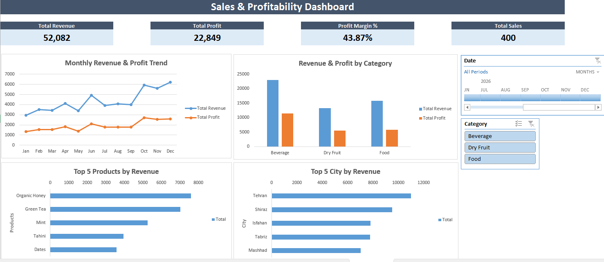

# Sales & Profitability Analysis | Excel BI Dashboard
## Project Overview

This project is an interactive Sales & Profitability Analysis Dashboard built using Microsoft Excel, Power Query, Power Pivot, and DAX.

The goal is to analyze sales performance, profitability, product categories, customer locations, and monthly trends through a dynamic business intelligence reporting solution.

The dashboard allows users to explore business performance using interactive filters and key performance indicators (KPIs).

## Dashboard Preview


## Dataset

The project uses a sample sales dataset covering January–December 2026.

| Dataset | Records | Description |
|---|---:|---|
| Sales | 400 | Sales transactions, quantities, prices, and related IDs |
| Products | 15 | Product information, categories, and costs |
| Customers | 20 | Customer information and locations |
| Date Table | 365 | Calendar data for time-based analysis |

The dataset includes three product categories: Beverage, Dry Fruit, and Food.

## Tools & Technologies

- **Microsoft Excel :** Dashboard development and reporting
- **Power Query :** Data import, transformation, and preparation
- **Power Pivot :** Data modeling and table relationships
- **DAX :** Business KPI calculations
- **PivotTables & PivotCharts :** Interactive analysis and visualization
- **Slicers & Timeline :** Dynamic filtering by product category and date

## Key Performance Indicators
The dashboard provides four main KPIs:

| KPI | Value |
|---|---:|
| Total Revenue | 52,082 |
| Total Profit | 22,849 |
| Profit Margin | 43.87% |
| Total Sales Transactions | 400 |

These values represent the full dataset with all filters cleared. Monetary units follow the sample dataset.

## Dashboard Features
The interactive dashboard includes:

### KPI Cards
- Total Revenue
- Total Profit
- Profit Margin
- Total Sales Transactions

### Interactive Charts
1. Monthly Revenue & Profit Trend
2. Revenue & Profit by Category
3. Top 5 Products by Revenue
4. Top 5 Cities by Revenue

### Interactive Filters
- **Category Slicer:** Filter results by product category.
- **Date Timeline:** Analyze performance across different time periods.

All KPI cards and charts respond dynamically to the selected filters.

## Data Preparation & Modeling
The reporting workflow follows these stages:

1. Import source Excel files using Power Query.
2. Prepare and transform the sales, product, and customer data.
3. Load the prepared data into the Excel Data Model.
4. Create relationships between the sales, product, customer, and date tables.
5. Define DAX measures for revenue, profit, profit margin, and transaction count.
6. Build PivotTables, PivotCharts, and interactive dashboard controls.

## Project Structure

```text
Sales_Profitability_Excel_BI/
├── data/
│ ├── Sales1.xlsx
│ ├── Products1.xlsx
│ └── Customers1.xlsx
├── report/
│ ├── query1.xlsx
│ └── Sales_Profitability_Dashboard.xlsx
├── images/
│ └── sales_dashboard.png
└── README.md
```

## How to Use
1. Download or clone the repository.
2. Open report/Sales_Profitability_Dashboard.xlsx in Microsoft Excel for Windows with Power Pivot support.
3. Navigate to the Dashboard worksheet to explore the saved report.
4. Use the Category Slicer and Date Timeline to filter the results.

**Note:** The dashboard contains saved results. Refreshing the underlying data on another computer requires updating the local source connections as explained below.

## Refreshing the Data

The project includes external Excel data connections.

To refresh the project on another computer:

1. Open report/query1.xlsx.
2. Update the Power Query parameter DataFolder to the local path of the downloaded data folder, including the trailing backslash.
3. Refresh the queries and save the workbook.
4. Open report/Sales_Profitability_Dashboard.xlsx.
5. Update its Power Pivot source connections to the local paths of report/query1.xlsx and data/Sales1.xlsx.
6. Refresh the Data Model and verify the dashboard results.

**Important:** Source connections currently require local path configuration when the project is moved to another computer.

## Business Value

This project demonstrates how Excel-based business intelligence can support:

- **Sales and Profitability Monitoring:** Track revenue, profit, and profit margins.
- **Product Performance Analysis:** Evaluate product and category performance.
- **Geographic Sales Analysis:** Compare sales performance across customer locations.
- **Monthly Trend Analysis:** Identify changes in sales and profitability over time.
- **Interactive Management Reporting:** Support business decisions through dynamic dashboards.

## Project Scope

This portfolio project uses sample data to demonstrate practical skills in Excel Business Intelligence, data modeling, DAX calculations, interactive dashboard development, and business performance reporting.

## Data Disclaimer

This project uses synthetic data created for educational and portfolio demonstration purposes.

All sales figures, financial metrics, customer information, and city-level performance results are fictional and do not represent actual business operations.

Real city names may be used for geographical analysis, but all associated numerical values are simulated.
